# 补阙 · 产品使用说明书

> 对照 **5173 开发界面**现行顶栏、侧栏与页面按钮（2026-09-20）。截图与正文均取自当前运行环境。  
> 菜单是否出现取决于账号权限。下文以**平台管理员**能看到的完整菜单为准。  
> 登录页 / 顶栏显示的产品名、版本、Logo 在「系统信息配置」维护（当前运行环境示例：**补阙漏洞管理系统** · **0.5Beta**）。默认品牌为 **补阙**。
>
> **打开地址**
> - 安装包 / Docker Desktop：http://127.0.0.1:8080 （前后端同一端口）
> - 本机开发（Vite + 后端）：界面 http://127.0.0.1:5173 ，接口 http://127.0.0.1:8080

目录：

1. [登录](#1-登录)
2. [界面结构与完整菜单](#2-界面结构与完整菜单)
3. [工作台](#3-工作台)
4. [漏洞中心 · 漏洞数据](#4-漏洞中心--漏洞数据)
5. [漏洞中心 · 扫描发现](#5-漏洞中心--扫描发现)
6. [漏洞中心 · 报告中心](#6-漏洞中心--报告中心)
7. [资产库](#7-资产库)
8. [系统管理](#8-系统管理)
9. [推荐使用顺序](#9-推荐使用顺序)
10. [常见问题](#10-常见问题)

---

## 1. 登录

打开系统地址后进入登录页。**不需要**导入授权文件。页上显示当前产品名、版本；简介为空时显示「请使用用户名或邮箱登录」。

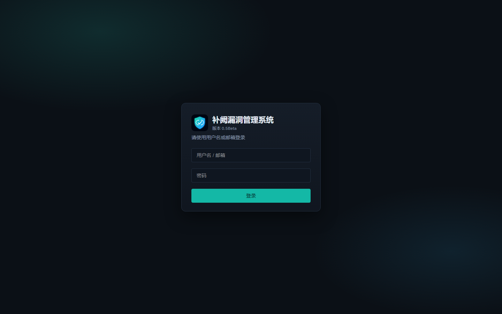

1. 输入用户名或邮箱、密码。  
2. 单击 **登录**。  
3. 若提示初始密码、密码过期或「请先修改密码」，会进入侧栏 **账号与改密**（页面标题为「账号与密码」），改完后再使用。  
4. 因空闲超时被踢出时，登录页会提示「会话已超时，请重新登录」。  
5. 登录成功后默认进入 **工作台 → 我的待办**（若该账号没有待办权限，则落到其第一个有权限的页面）。

预置账号：`admin`（平台管理员）、`dev_owner`、`sec_analyst`。初始密码见仓库 README 或安装包 README（首次登录须修改）。**请勿把当前环境密码写进文档或提交到仓库。**

全新安装（含 Docker 安装包）**不会预置**组织树、项目、应用系统、系统模块或漏洞数据，列表为空是正常现象。请先按第 9 节建组织和资产，再录入或扫描。

右上角头像菜单可 **账号与改密** 或 **退出登录**。长时间无操作会按密码策略超时，需重新登录。

---

## 2. 界面结构与完整菜单

登录后为三栏布局：

```
┌─────────────────────────────────────────────────────────┐
│  Logo 产品名 v版本   工作台 | 漏洞中心 | 资产库 | 系统管理   铃铛 用户 │
├──────────┬──────────────────────────────────────────────┤
│ 当前模块 │  页面标题 + 工具栏按钮                         │
│ 侧栏分组 │  筛选区 / 表格 / 表单                         │
│ （可折叠）│                                              │
└──────────┴──────────────────────────────────────────────┘
```

| 区域 | 作用 |
|------|------|
| 顶栏四个模块 | 切换工作台、漏洞中心、资产库、系统管理 |
| 左侧分组 | 当前模块下的页面；分组标题可折叠/展开，当前页所在分组会自动展开 |
| 右上铃铛 | 未读数量角标；点开预览最近消息，点「全部」进入工作台「消息」 |
| 表格行内按钮 | 详情、办理、编辑等 |

当前登录身份显示在右上角，例如「系统管理员 (admin) · 平台管理员」。

### 2.1 平台管理员完整菜单（与 5173 侧栏一致）

**工作台**

| 侧栏 | 说明 |
|------|------|
| 我的待办 | 工单待办中心 |
| 消息 | 站内信收件箱 |

**漏洞中心**

| 分组 | 侧栏 | 说明 |
|------|------|------|
| 漏洞数据 | 漏洞列表 | 资产漏洞主列表；录入、详情不在侧栏 |
| 漏洞数据 | 漏洞基线 | 专项基线集合 |
| 漏洞数据 | 漏洞白名单 | 加白规则 |
| 漏洞数据 | 监管漏洞 | 监管台账 |
| 扫描发现 | 任务列表 | 检测任务；「发起检测任务」从本页进入 |
| 扫描发现 | 扫描对比 | 两次任务/作业对比 |
| 扫描发现 | 任务门禁 | 入库后门禁策略 |
| 报告中心 | 报告列表 | 页面标题为「报告中心」 |

**资产库**

| 分组 | 侧栏 | 说明 |
|------|------|------|
| 项目 | 项目资产 | 三层资产顶层 |
| 应用 | 应用系统 | 挂在项目下 |
| 应用 | 系统模块 | 缩进显示在应用系统下；漏洞画像从行内进入，不在侧栏 |

**系统管理**

| 分组 | 侧栏 | 说明 |
|------|------|------|
| 组织权限 | 组织架构 | 部门树 |
| 组织权限 | 人员维护 | 账号、部门、角色 |
| 组织权限 | 角色权限 | 菜单范围 / 数据权限 / 成员 |
| 组织权限 | 账号与改密 | 改自己的密码；页面标题「账号与密码」 |
| 平台配置 | 系统信息配置 | 产品名、版本、简介、Logo、授权 |
| 平台配置 | 大模型配置 | 接口与提示词 |
| 平台配置 | 漏洞信息配置 | 类型 / 监管匹配 / 去重 / 自动关闭 |
| 平台配置 | 漏洞字段目录 | 扩展字段、核心字段 |
| 平台配置 | 密码策略管理 | 复杂度、会话超时、更换周期 |
| 平台配置 | 消息通知 | 工单站内信模板 |
| 检测接入 | 工具实例 | 扫描工具对接 |
| 检测接入 | 清洗映射配置 | 工具字段 → 平台字段 |
| 流程 | 流程管理 | 工单阶段与绑定规则 |
| 审计 | 日志管理 | 操作审计 |

当前版本**不显示**「平台更新」（功能开关关闭）。侧栏没有单独的「录入漏洞」「发起检测任务」「漏洞详情」「工单详情」「漏洞画像」，这些从列表或行内进入。

---

## 3. 工作台

### 3.1 我的待办

路径：工作台 → **我的待办**

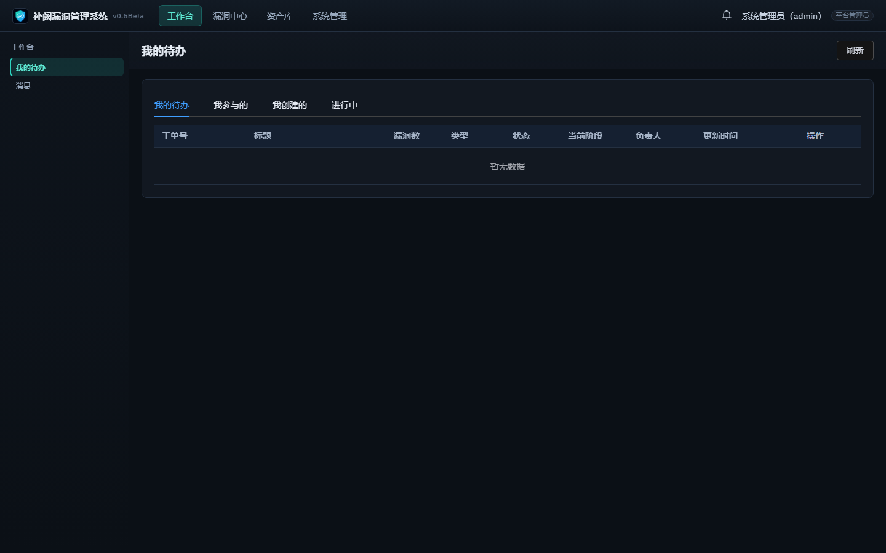

顶部四个页签切换不同工单集合（列结构相同，数据范围不同）：

| 页签 | 谁能看 | 内容 |
|------|--------|------|
| 我的待办 | 所有人 | 当前指派给你、需要你办理的工单。没有待办时显示「暂无数据」 |
| 我参与的 | 所有人 | 你曾经处理、审批或被转派过的工单（含已结束） |
| 我创建的 | 所有人 | 由你发起（录入/批量发起处置）的工单 |
| 进行中 | 仅平台管理员 | 系统内全部未办结工单，用于督办 |

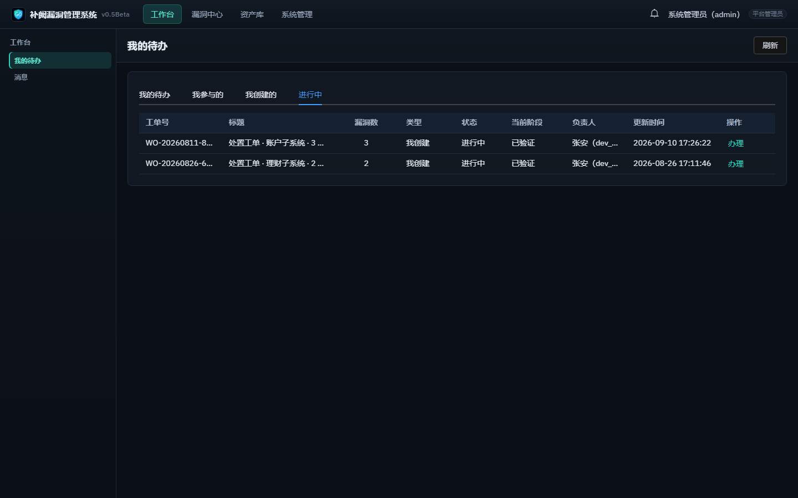

列：工单号、标题、漏洞数、类型、状态、当前阶段、负责人、更新时间。

类型取值：待审批 / 待办理 / 曾审批 / 我创建。状态：进行中 / 已结束 / 已取消。

操作：

1. 进行中工单点 **办理**，已结束点 **查看**，进入工单详情。  
2. 漏洞数列若出现「拆单」标签，表示流转通过后会按子项结论拆出新工单。  
3. 点 **刷新** 重新拉取当前页签。

### 3.2 工单详情

从待办进入。左上 **← 返回待办**。上方是工单摘要（工单号、状态、标题、阶段、处置状态、当前处理人、流程、漏洞数）；若由拆单产生，会显示 **拆自工单**（可点回原单）。可 **下载漏洞整改清单（xlsx）**。下方两个页签：

| 页签 | 作用 |
|------|------|
| 办理 | 处理子项、上传附件、点流转按钮、审批 |
| 流程图与处理进度 | 只看阶段进度和下一步，不改数据 |

#### 办理

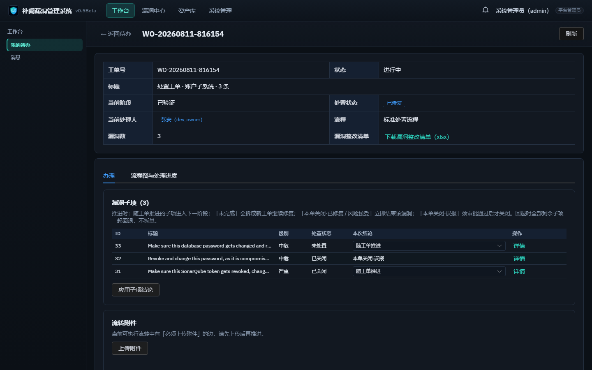

- **待审批**（若有）：审批人可填意见后 **通过 / 驳回**；其他人只能等待。通过后若将拆单，页上会预览「本单保留 / 拆出续修 / 本单关闭」条数。  
- **漏洞子项**：每条可选本次结论——随工单推进、未完成（通过后拆单续修）、本单关闭·已修复 / 风险接受 / 误报。改完点 **应用子项结论**。  
- **流转附件**：流程边要求「必须上传附件」时，先上传再推进。  
- **办理按钮**：按「阶段与流转」配置出现推进 / 回退 / 异常按钮；需审批的会标注。有权限时还可 **转派**。  
- **审批记录**：历史通过/驳回。

点处置状态或处理人标签，可弹出处理过程。

#### 流程图与处理进度

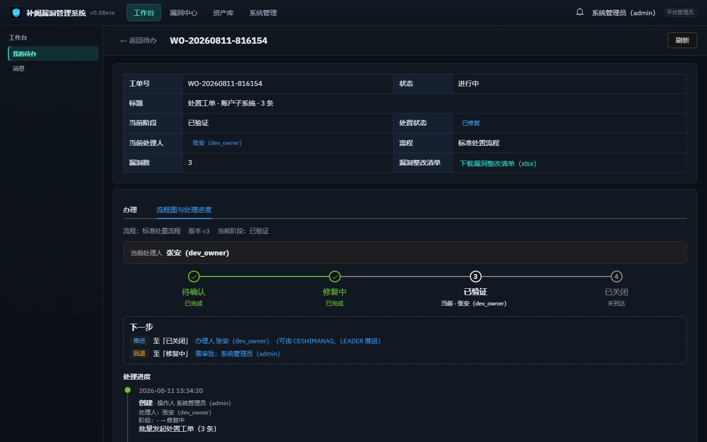

展示当前所用流程版本、已完成/当前/未到达阶段、当前处理人、下一步可执行动作（谁能推进、是否需审批），以及处理进度时间线。办结后回到待办列表。

### 3.3 消息

路径：工作台 → **消息**

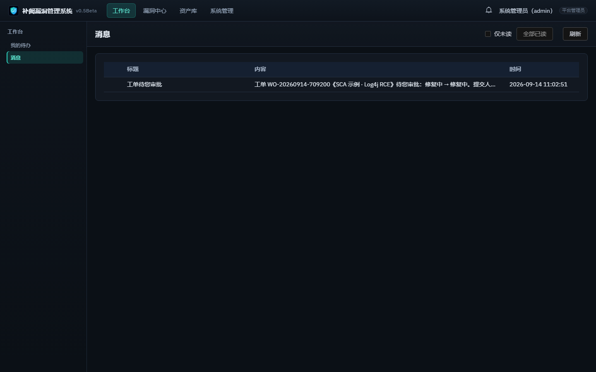

站内信收件箱。未读可在顶栏铃铛看到数量；点铃铛可预览最近几条，点「全部」进入本页。可勾选 **仅未读**，或点 **全部已读**、**刷新**。点一行会标记已读并按事件跳转。事件种类与文案在 **系统管理 → 消息通知** 配置。

---

## 4. 漏洞中心 · 漏洞数据

### 4.1 漏洞列表

路径：漏洞中心 → 漏洞数据 → **漏洞列表**

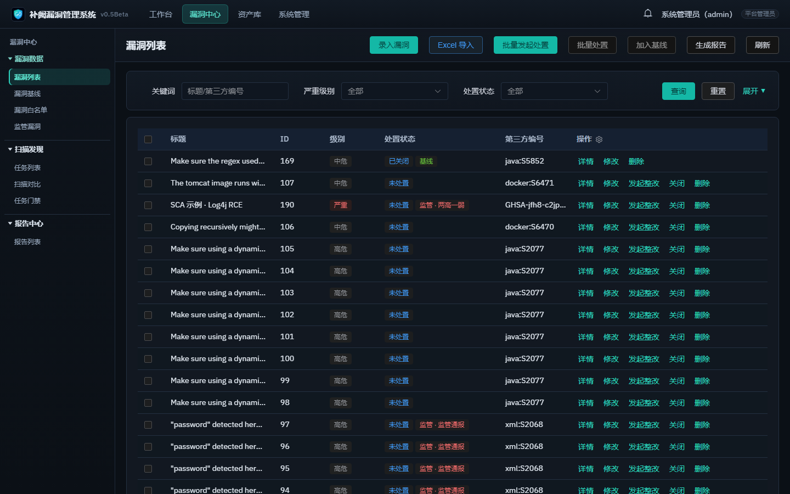

工具栏：

| 按钮 | 作用 |
|------|------|
| 录入漏洞 | 打开手工录入页（不在侧栏） |
| Excel 导入 | 按模板批量导入 |
| 批量发起处置 | 打开对话框：可对**已勾选**或**当前筛选结果**发起工单（筛选模式须先选系统模块，仅未处置，最多 500 条） |
| 批量处置 | 须先勾选，改处置状态 |
| 加入基线 | 须先勾选，纳入某条基线 |
| 生成报告 | 按当前范围生成「漏洞报告」，结果在报告列表 |
| 刷新 | 重新查询 |

筛选：关键词（标题/第三方编号）、严重级别、处置状态。点 **展开** 还可筛：

| 展开项 | 说明 |
|--------|------|
| 安全基线 | 在基线中 / 不在基线 |
| 白名单 | 已加白 / 未加白 |
| 监管漏洞 | 是监管漏洞 / 非监管漏洞 |
| 监管来源 | 两高一弱、监管通报等 |
| 应用系统 / 系统模块 | 按资产范围 |
| 发现工具 | 按工具实例 |
| 更新时间 | 日期区间 |

点 **查询** / **重置**。表格「操作」列右侧齿轮为 **列设置**：可勾选显示 ID、标题（必显）、级别、处置状态、第三方编号、更新时间，以及「漏洞字段目录」里勾了「列表可见」的扩展字段。列配置按当前账号保存。

行内操作（视权限与状态）：**详情**、**修改**、待处置点 **发起整改**、处置中点 **标记已修**、**关闭**、**删除**。删除为逻辑删除，存在活跃工单时须先结束工单。命中监管台账的条目会带 **监管·监管通报** 等红色标签；处置状态旁还可能出现基线、白名单、误报等标记。

#### 漏洞详情

点 **详情** 进入。左上 **← 返回列表**。标题旁显示级别、处置状态，以及误报 / 风险接受 / 基线 / 已加白 / 监管漏洞等标签。工具栏按状态出现：

| 按钮 | 何时出现 |
|------|----------|
| 修改信息 | 有编辑权限 |
| 工单办理 | 已有活跃工单且你能办理 |
| 发起整改 | 处置状态为未处置 |
| 推进（已修复） | 处置状态为处置中 |
| 关闭 | 处置状态为已修复 |
| 标误报 / 风险接受 | 尚未打上对应标记 |
| 加入基线 / 加白 | 尚未纳入 |
| 强制关闭 | 有强制权限且尚未关闭 |
| 删除 | 有删除权限 |

正文页签：

| 页签 | 内容 |
|------|------|
| 基本信息 | 字段、资产归属、来源扩展字段、CVSS、描述/影响/复现证据/修复建议/参考链接 |
| AI解读 | 仅当「大模型配置」已启用并接通时出现 |
| 处置流程与过程 | 关联工单、流程阶段条、处置过程时间线 |

**基本信息**

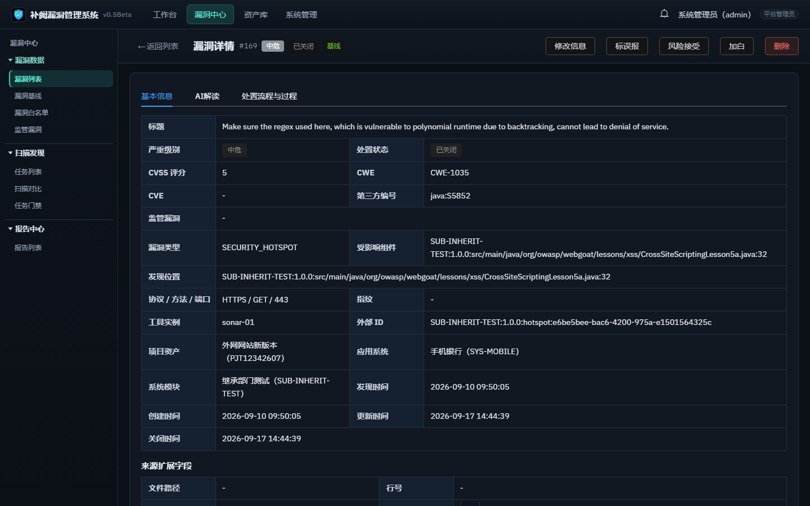

命中监管台账时，标题旁会出现 **监管漏洞** 标签，「监管漏洞」字段显示台账编号与机构（可点进监管台账），含修复截止日：

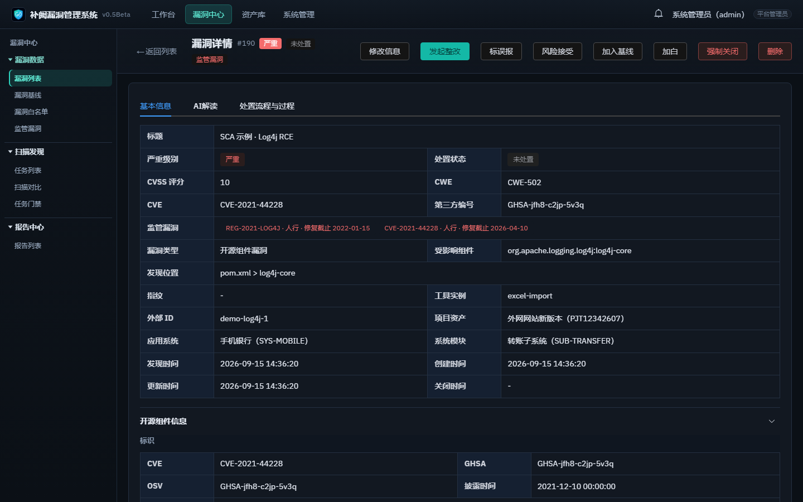

开源组件类漏洞还会展开「开源组件信息」（CVE/GHSA/OSV、受影响版本、修复版本、依赖层级、CPE 等）。页底「操作审计」记录字段级变更。

**AI解读**

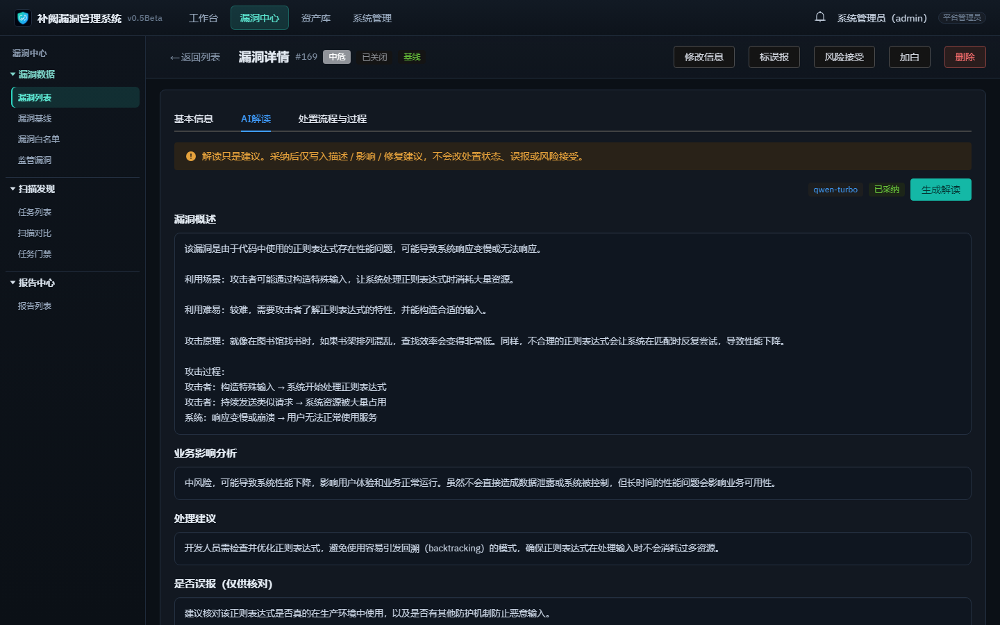

启用大模型后才会出现此页签。点 **生成解读**，按本条漏洞的类型选用提示词（有类型专用条目则用专用，否则用「漏洞AI解读」通用默认），整理成：漏洞概述、业务影响分析、处理建议、是否误报（仅供核对）、可转交研发/运维的清单。

解读只是建议。点 **采纳并写入** 时，可勾选：写入修复建议、用概述覆盖漏洞描述、用业务影响覆盖影响分析；**不会**改处置状态、误报或风险接受。提示词在「系统管理 → 大模型配置」维护。

**处置流程与过程**

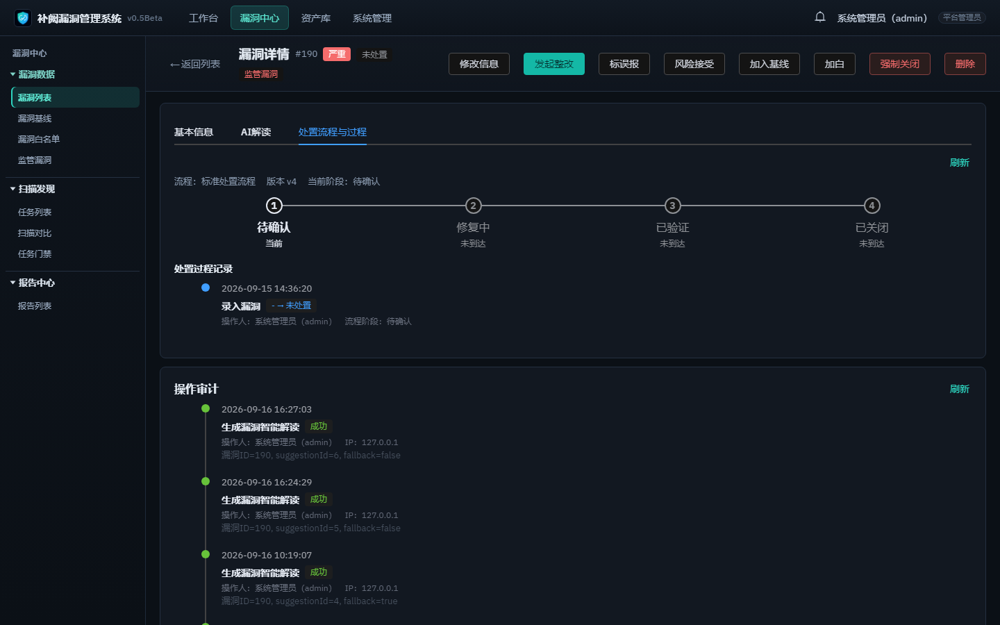

显示匹配到的流程名称与版本、当前阶段。若已发起工单，可点 **办理** 跳到工单。下方时间线记录每次状态变更、操作人和备注。尚未发起处置时阶段停在初始态、过程记录为空。

### 4.2 录入漏洞

从列表点 **录入漏洞**（页面不在侧栏）。可 **返回列表**。

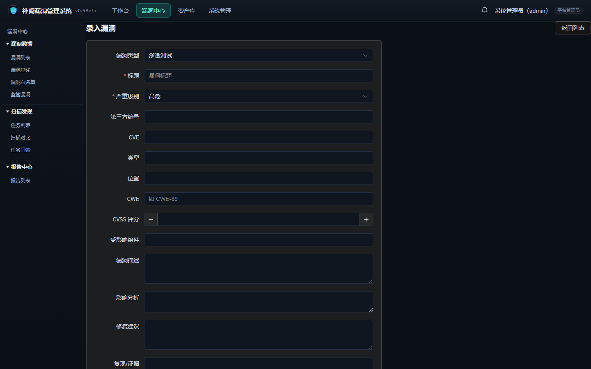

表单项自上而下：漏洞类型（下拉来自「漏洞信息配置 → 漏洞类型」已启用项）、标题、严重级别、第三方编号、CVE、类型、位置、CWE、CVSS、受影响组件、描述、影响分析、修复建议、复现/证据、参考链接、来源扩展字段、项目 / 应用系统 / 系统模块。点 **保存并入库**。与扫描入库共用去重规则（见第 8.7 节）。

### 4.3 漏洞基线

路径：漏洞中心 → 漏洞数据 → **漏洞基线**

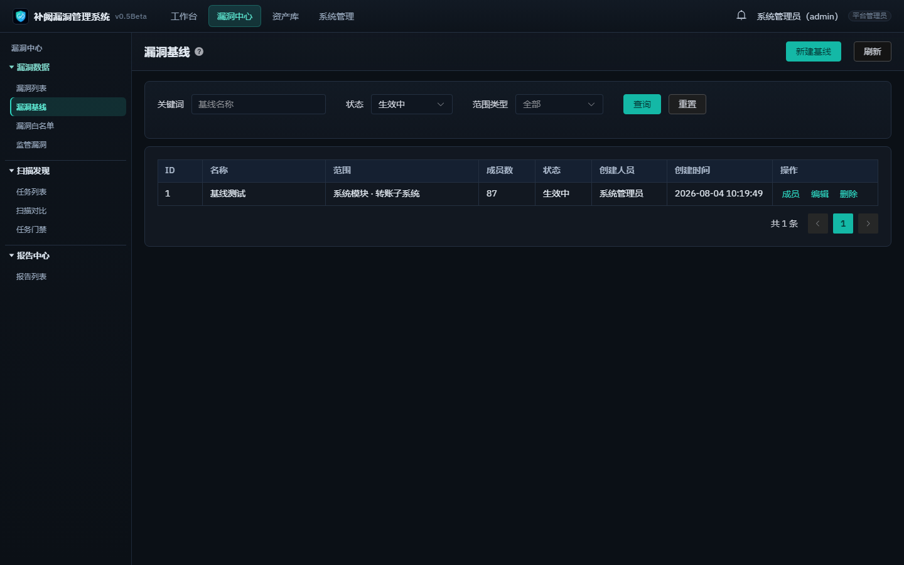

用途：纳入基线的漏洞按专项计划治理，**不再进入日常「待跟踪 / 待处置」清单**。扫描仍会发现并保留记录。状态为「生效中」时保持豁免；设为「失效」后取消豁免，漏洞详情不再显示「基线」标签。

可 **新建基线**（名称、范围类型为应用系统或系统模块、状态、说明）。列表可按关键词、状态、范围筛选。行内 **成员**、**编辑**、**删除**。成员请在漏洞列表勾选后「加入基线」，或在漏洞详情加入；成员抽屉可查看并移出。扫描任务详情会统计 **基线命中**。

### 4.4 漏洞白名单

路径：漏洞中心 → 漏洞数据 → **漏洞白名单**

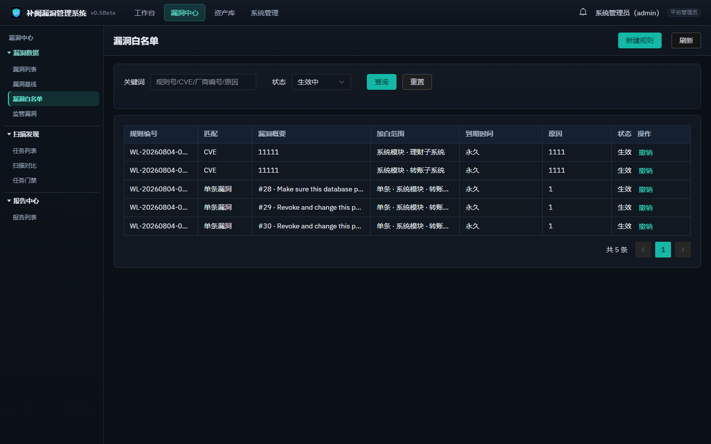

点 **新建规则**，匹配方式：单条漏洞 / CVE / 厂商编号，并设置加白范围与到期时间（可永久）。筛选：规则号/CVE/厂商编号/原因，以及状态（生效中 / 已过期 / 已撤销）。命中且仍在有效期内的漏洞在列表带白名单标记；任务详情统计 **白名单命中**。行内 **撤销** 可使规则失效。

### 4.5 监管漏洞

路径：漏洞中心 → 漏洞数据 → **监管漏洞**

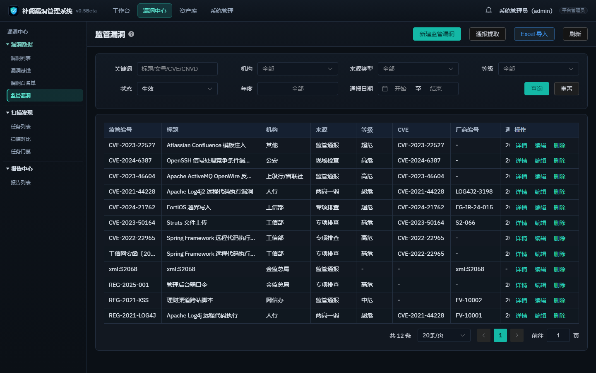

这是**独立台账**，不是资产漏洞列表里的一个勾选。

工具栏：**新建监管漏洞**、**通报提取**（大模型接通后才出现）、**Excel 导入**、**刷新**。本页**没有**「生成报告」按钮。

筛选：关键词（标题/文号/CVE/CNVD）、机构、来源类型、等级、状态、年度、通报日期。

1. **新建监管漏洞**：填监管编号、标题、机构、来源类型；建议填写 **厂商编号**（与扫描漏洞的第三方编号一致，例如 `xml:S2068`），或 CVE / CNVD / CNNVD。  
2. **通报提取**：上传 PDF / Word / Excel 或粘贴正文，点 **提取**。文中有几条漏洞就列出几条草稿；点 **修改** 可改后再勾选，**全选 / 取消全选**，点 **入库所选** 一次写入台账（**不会自动创建**）。监管编号已存在则跳过。仓库 `docs/templates/监管通报提取测试/` 有一份混排测试 PDF 可用来验证。  
3. **Excel 导入**：先 **下载模板与示例** 再导入。监管台账的「来源类型」是两高一弱 / 监管通报等，与资产漏洞的平台漏洞类型不是同一套字典。  
4. 保存后按「漏洞信息配置」里的匹配字段自动关联资产漏洞；详情里可 **重新匹配**、**手工关联** 或 **解除**。  
5. 列表「命中」列为已关联的资产漏洞数量。行内 **详情 / 编辑 / 删除**。  
6. 资产漏洞详情、扫描任务详情可看到监管命中。

自动匹配规则：系统管理 → 漏洞信息配置 → 监管漏洞自动关联（拖拽启用字段）。厂商编号为空时，也可用监管编号去对齐第三方编号。

---

## 5. 漏洞中心 · 扫描发现

### 5.1 任务列表

路径：漏洞中心 → 扫描发现 → **任务列表**

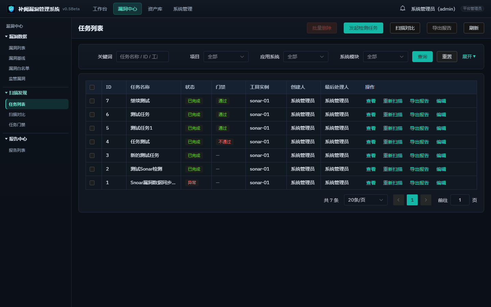

工具栏（从左到右）：**批量删除**（须勾选）、**发起检测任务**、**扫描对比**、**导出报告**（须勾选）、**刷新**。

1. 筛选：关键词（任务名称 / ID / 工具实例）、项目、应用系统、系统模块；展开可筛状态、工具实例、创建人、创建时间。  
2. 列表列：ID、任务名称、状态（暂存 / 待开始 / 进行中 / 已完成 / 异常）、门禁（通过 / 不通过）、工具实例、创建人、最后处理人、项目、应用系统（可带版本）、系统模块（可带版本）、仓库、创建/开始/结束时间。  
3. 状态为「异常」时可点标签查看错误；门禁「不通过」可点查看原因。  
4. 行内：**查看**（详情抽屉）、草稿 **继续填写**、草稿 **执行** 或已完成任务 **重新扫描**；部分任务显示 **重新拉取**（从工具再拉结果，而不是整次重扫）、**导出报告**、**编辑**。

#### 发起检测任务

从任务列表点 **发起检测任务**（不在侧栏；侧栏仍高亮「任务列表」）。草稿再进时标题为 **继续填写检测任务**。可 **返回任务列表**。

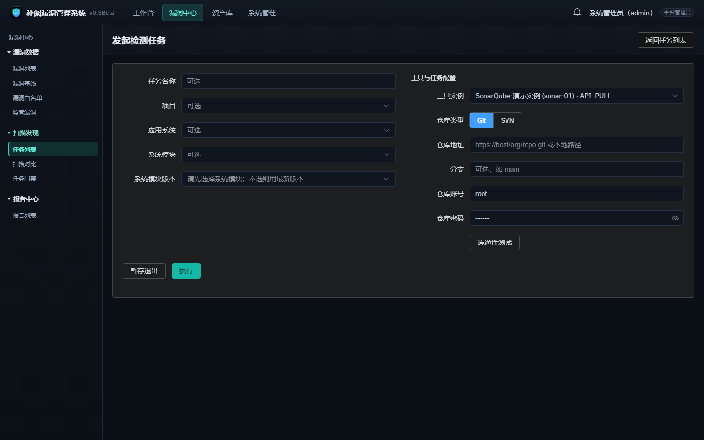

左侧：任务名称（可选）、项目 / 应用系统 / 系统模块、系统模块版本（不选则用最新）。右侧「工具与任务配置」：

- **SonarQube 类工具**：仓库类型 Git / SVN、仓库地址、分支、仓库账号密码（默认用工具实例）、**连通性测试**，再 **暂存退出** 或 **执行**。  
- **其他工具**：只填 **分析分支**（可选）；本页没有「执行」，回到任务列表用 **重新拉取**。

**不要在发起页选手动门禁策略。** 任务结束后，系统按「任务门禁」里**已启用且范围命中**的策略自动判定通过/不通过。

#### 任务执行详情

点行内 **查看** 打开右侧抽屉。

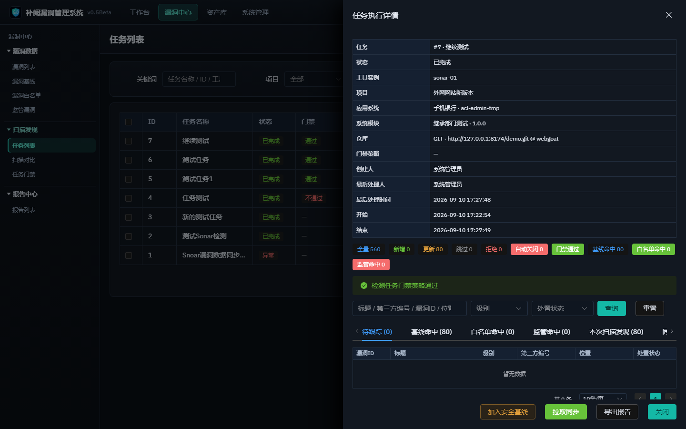

上半部分是任务基本信息（含自动命中的门禁策略名称）与统计标签（全量、新增、更新、跳过、拒绝、自动关闭、门禁、基线/白名单/监管命中）。门禁不通过时有告警条。筛选框对下列页签同时生效（标题 / 第三方编号 / 漏洞ID / 位置、级别、处置状态；发现类页签还可筛入库结果）。底部可 **加入安全基线**、**拉取同步**、**导出报告**。

抽屉底部一排页签（数量为该页签条数；可用左右箭头滚动）：

| 页签 | 看什么 |
|------|--------|
| 待跟踪 | 仍需处置、未关闭的资产漏洞 |
| 基线命中 | 落在安全基线内的漏洞 |
| 白名单命中 | 命中生效白名单规则的漏洞 |
| 监管命中 | 命中监管台账的漏洞（监管编号、监管来源列） |
| 本次扫描发现 | 最近一次同步拉到的 findings 及入库结果（新增/更新/跳过/拒绝） |
| 同步作业 | 历次同步作业：状态、新增/更新/跳过/拒绝/自动关闭、门禁通过与否 |
| 全量发现 | 该任务历史上全部 findings，不只最近一次 |

**监管命中**

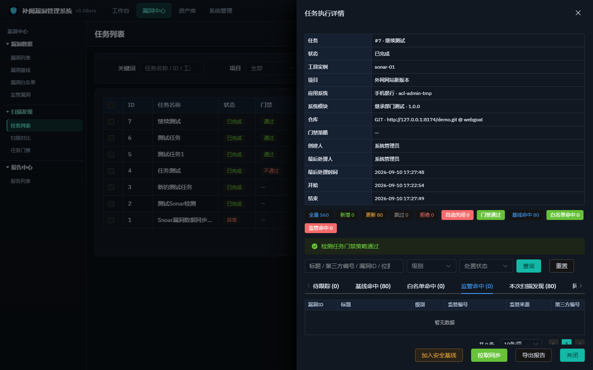

数量为 0 表示这次扫描没有匹配到台账。有命中时可点监管编号跳到台账。

**基线命中**

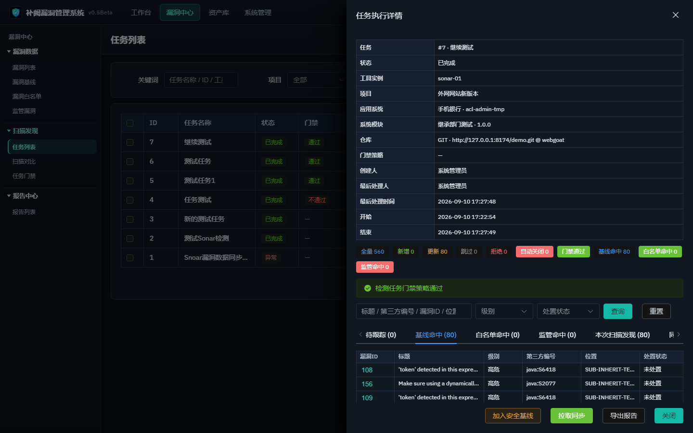

**本次扫描发现**

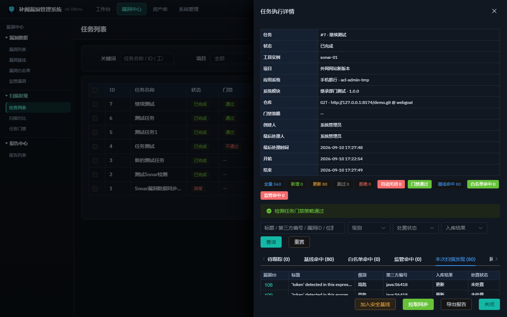

**同步作业**

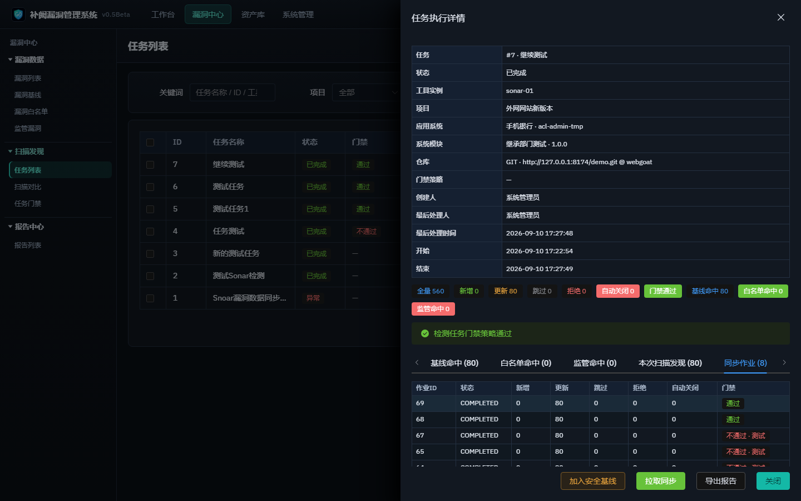

同一任务可多次拉取，每条作业单独记门禁结果。

**全量发现**


### 5.2 扫描对比

路径：漏洞中心 → 扫描发现 → **扫描对比**

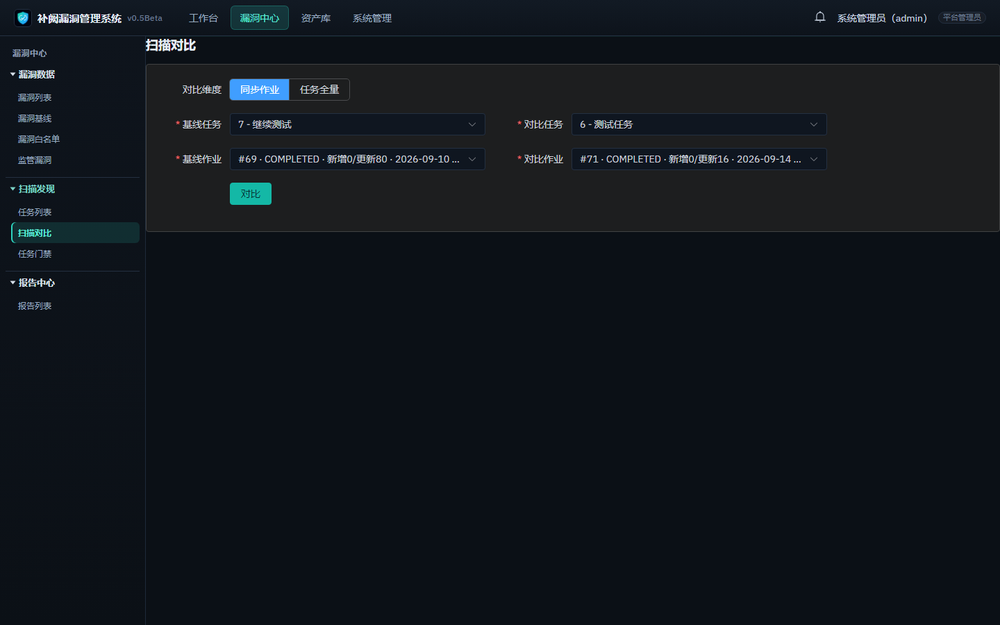

先选对比维度，再选两侧任务（作业模式下还要选同步作业），点 **对比**：

| 维度 | 含义 |
|------|------|
| 同步作业 | 两次具体拉取之间的差异（适合同任务复扫） |
| 任务全量 | 两个任务各自全量结果对比 |

对比成功后，上方汇总卡片（新入库 / 已修复 / 仍开放 / 回归 / 净变化），下方两层页签：

| 层 | 内层页签 |
|----|----------|
| 漏洞层 | 新入库、已修复、仍开放、回归（资产漏洞粒度，可点进详情） |
| 发现层 | 新增上报、再次上报、本次未再上报、更新入库（工具 findings 粒度，含入库结果） |

基线任务若是草稿、未选作业，点对比不会出结果，需换成已完成任务并补全作业。

### 5.3 任务门禁

路径：漏洞中心 → 扫描发现 → **任务门禁**

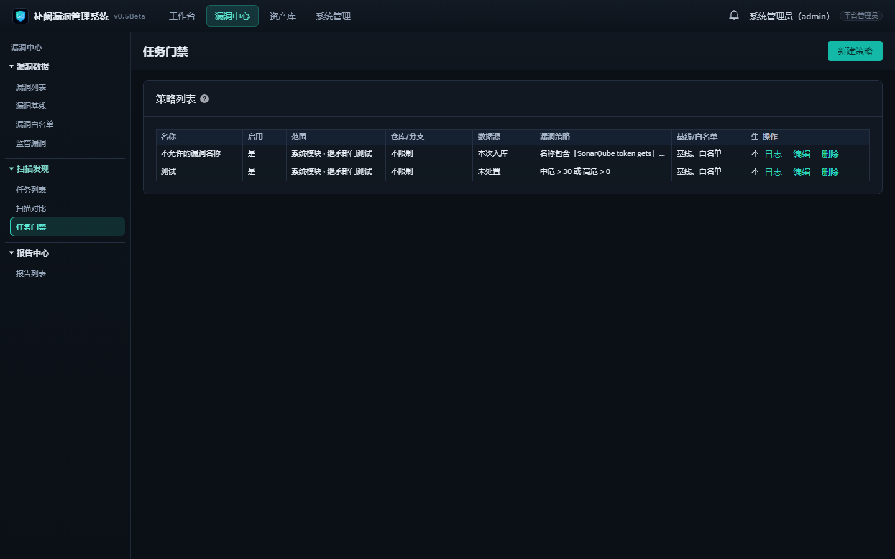

点 **新建策略**。任务结束后按启用中的策略判定 **通过 / 不通过**（未命中或未触发失败条件则通过），原因显示在任务详情与列表门禁列。列表「触发次数」可点开 **日志**（按任务名称/ID/规则、触发时间筛选）。行内还可 **编辑**、**删除**。

可配置项：

| 项 | 说明 |
|----|------|
| 生效范围 | 全平台 / 项目 / 应用系统 / 系统模块 |
| 仓库地址、分支 | 可选，空则不限制 |
| 生效时间 | 可选时间窗 |
| 数据源 | 本次入库 / 未处置 / 未关闭 |
| 关联基线、白名单 | 计入或排除 |
| 条件关系 | 或（任一命中即不通过）/ 与（全部命中才不通过） |
| 漏洞策略 | 可多条。计数：严重级别、监管漏洞条数；也可按监管编号/来源、标题、编号、CVE、CNVD、CNNVD、CWE、GHSA、类型、组件、位置、描述、指纹等「包含」后计数（大于 N 则触发） |

---

## 6. 漏洞中心 · 报告中心

路径：漏洞中心 → 报告中心 → **报告列表**（页面标题 **报告中心**）

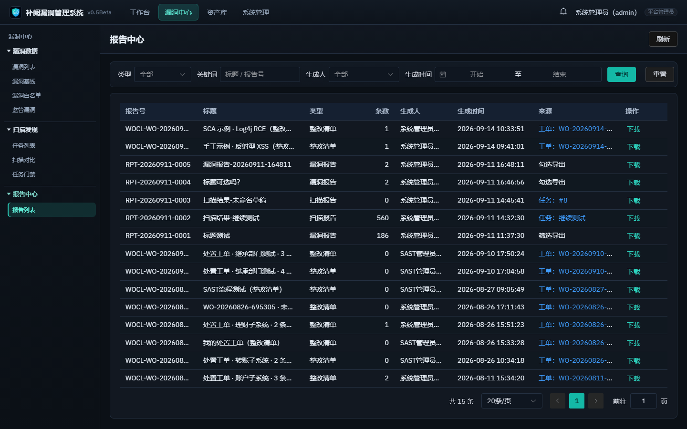

从漏洞列表点「生成报告」，或从任务列表 / 任务详情点「导出报告」后，到这里查看并 **下载**。监管台账页本身不生成报告。类型包括：漏洞报告、整改清单、扫描报告、监管报告。可用类型、关键词（标题/报告号）、生成人、生成时间筛选。列表还有「来源」列，可跳回对应漏洞列表、工单或任务。工具栏 **刷新**。

---

## 7. 资产库

### 7.1 项目资产

路径：资产库 → 项目 → **项目资产**

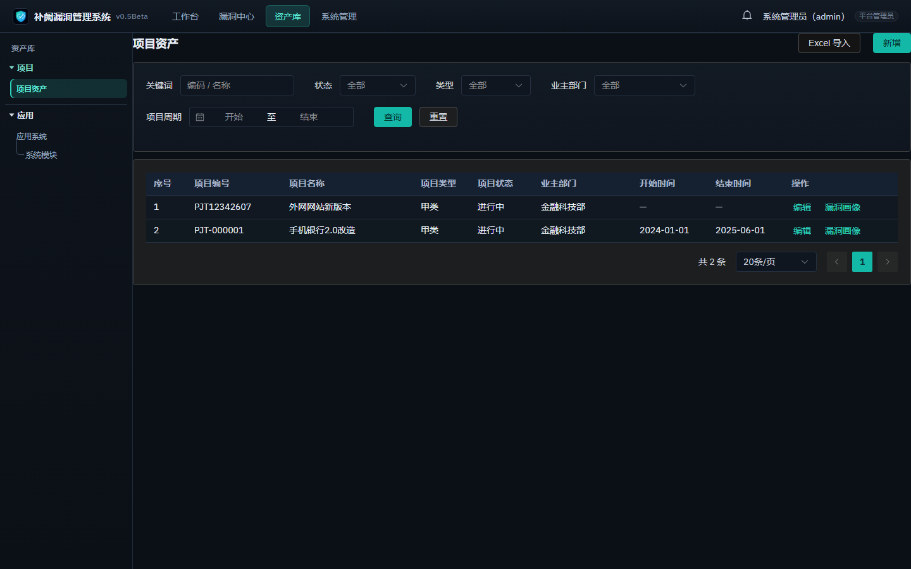

三层资产的顶层。工具栏 **Excel 导入**、**新增**。筛选：关键词（编码/名称）、状态、类型、业主部门、项目周期。行内 **编辑**、**漏洞画像**。

### 7.2 应用系统

路径：资产库 → 应用 → **应用系统**

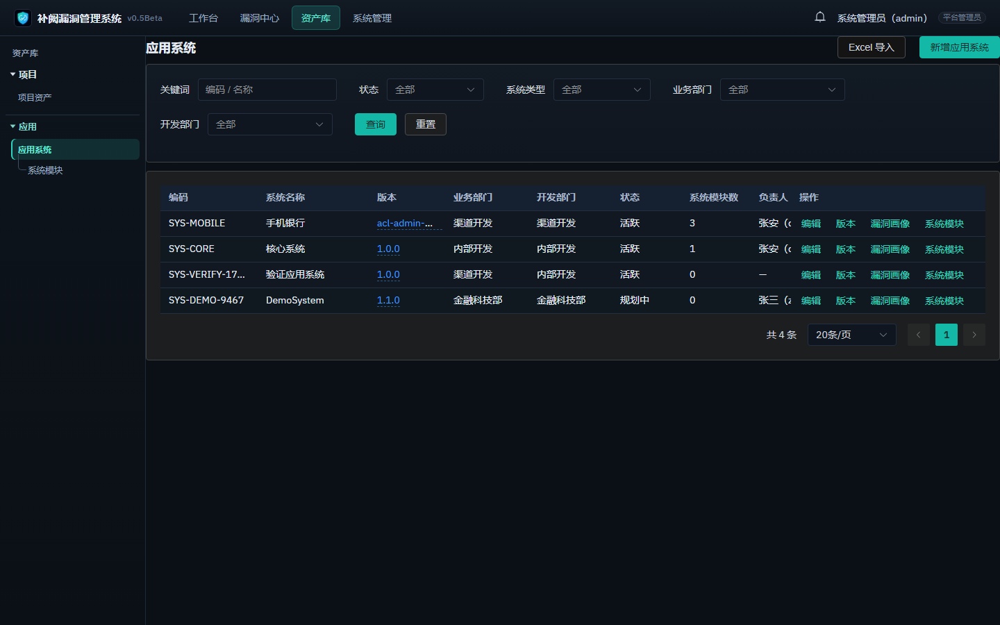

挂在项目之下。工具栏 **Excel 导入**、**新增应用系统**。筛选：关键词、状态、系统类型、业务部门、开发部门。列表含最新版本（可弹出版本列表）。行内 **编辑**、维护 **版本**、打开 **漏洞画像**、进入下属 **系统模块**。

### 7.3 系统模块

路径：资产库 → 应用 → **系统模块**

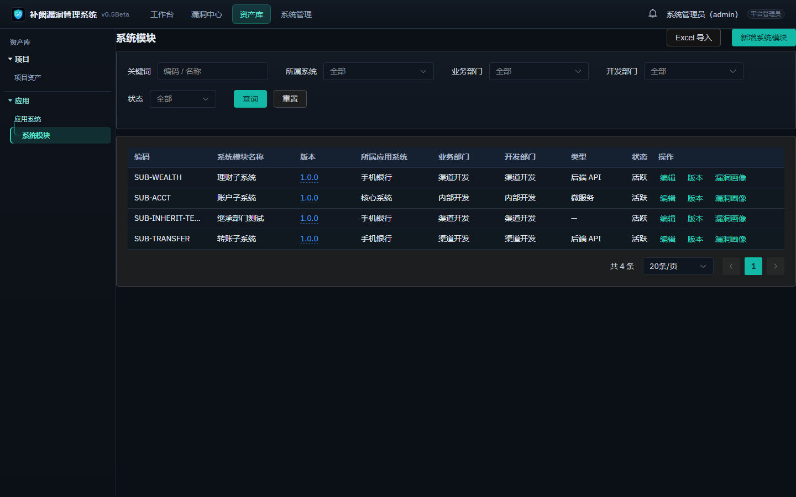

扫描任务、漏洞数据范围通常挂到模块。工具栏 **Excel 导入**、**新增系统模块**。筛选：关键词、所属系统、业务部门、开发部门、状态。行内同样可进 **漏洞画像**、维护版本。

### 7.4 漏洞画像

不在侧栏单独列出。在项目、应用系统或系统模块的行内点 **漏洞画像**。

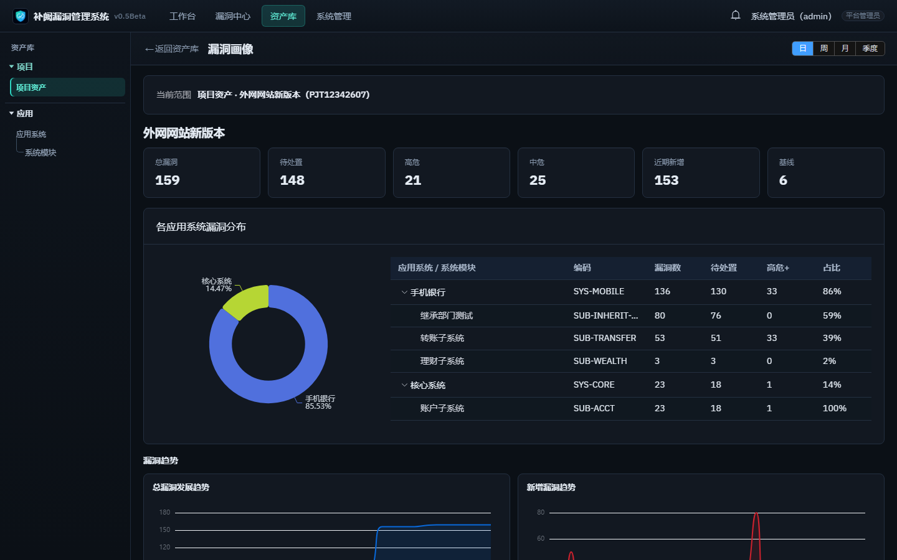

页面没有左右 Tab，按区块阅读；右上 **日 / 周 / 月 / 季度** 只影响趋势图粒度。

| 区块 | 内容 |
|------|------|
| 范围条 | 当前项目 / 应用系统 / 系统模块 |
| 统计卡 | 总漏洞、待处置、高危、中危、近期新增、基线 |
| 各应用系统漏洞分布 | 仅项目范围：饼图 + 系统/模块树表（漏洞数、待处置、高危+、占比） |
| 漏洞趋势 | 总漏洞、新增、待处置、基线数量四张图 |
| 待处置漏洞 | 可按关键词、级别筛选，点标题进漏洞详情 |

用于经营/安全汇报，而不是逐条处置。点 **返回资产库** 回到来源页。

---

## 8. 系统管理

### 8.1 组织架构

路径：系统管理 → 组织权限 → **组织架构**

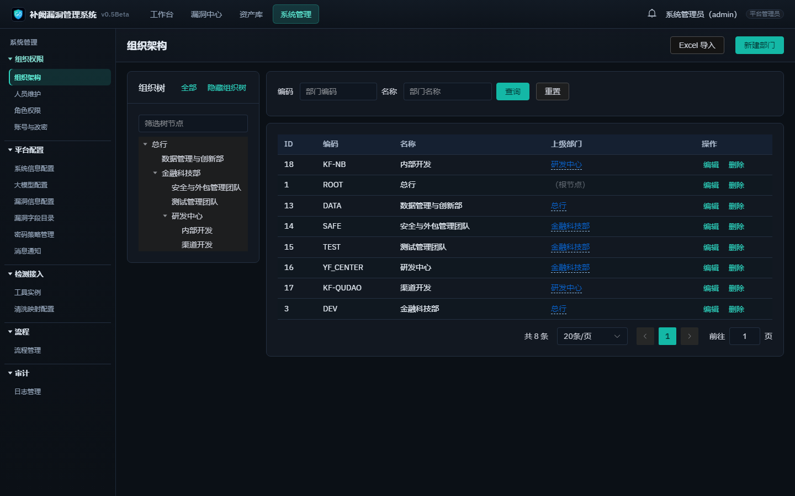

左侧组织树，右侧部门列表。树顶有 **全部**（取消树筛选，列出所有部门）和 **隐藏组织树**（加宽表格；再点「打开组织树」恢复）。树上点部门会过滤右侧列表。可 **新建部门**、**Excel 导入**、**编辑**、**删除**。人员、资产的业务部门都挂在这里。

### 8.2 人员维护

路径：系统管理 → 组织权限 → **人员维护**

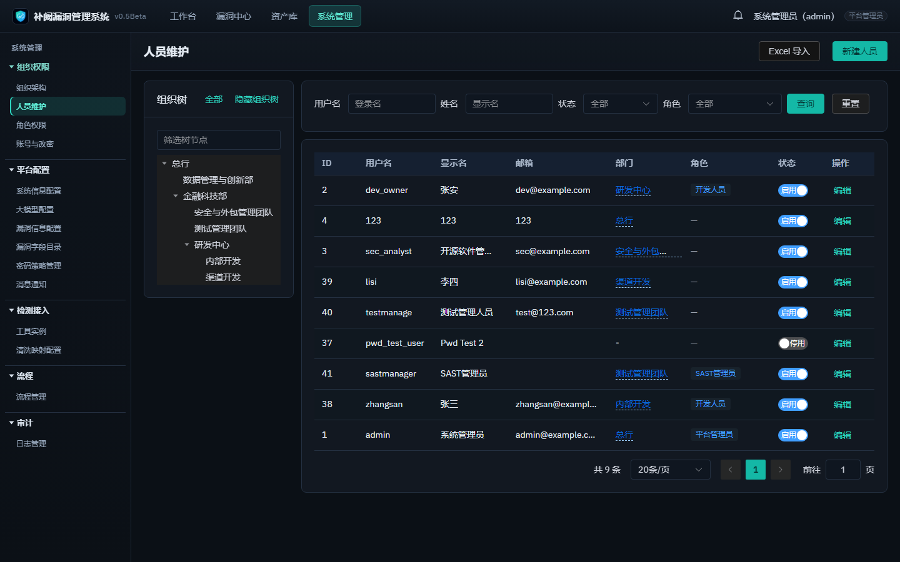

同样有左侧组织树（全部 / 隐藏组织树）。筛选：用户名、姓名、状态、角色。维护用户、绑定部门与角色、启用/停用。可 **新建人员**、**Excel 导入**。管理员可在编辑里重置密码。

### 8.3 角色权限

路径：系统管理 → 组织权限 → **角色权限**

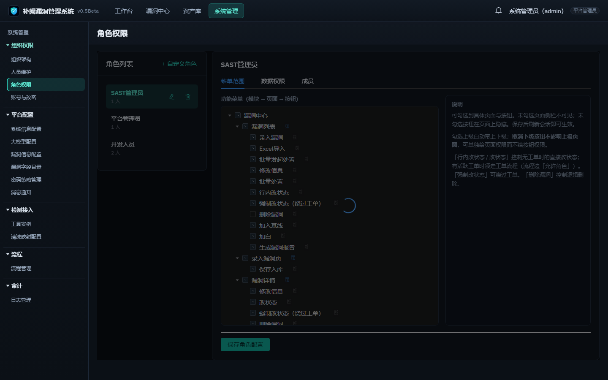

左侧选角色（可 **+ 自定义角色**、改名、删除；平台管理员角色不可删）。右侧三个页签，改完点底部 **保存角色配置**。

**菜单范围**

勾选「模块 → 页面 → 按钮」。未勾选页面侧栏不可见；未勾选按钮在页面上隐藏。勾选上级会带上下级；**取消下级按钮不影响上级页面**，可只给页面权限。

「行内改状态 / 改状态」控制无工单时的直接改状态；有活跃工单时须走工单流程（流程边「允许角色」）。「强制改状态」可绕过工单。「删除漏洞」控制逻辑删除。

**数据权限**

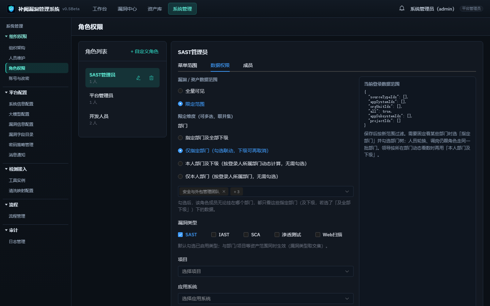

| 选项 | 含义 |
|------|------|
| 全量可见 | 不按资产过滤 |
| 限定范围 | 按下面维度取**并集**；扫描工具类型与资产范围取**交集** |

限定部门时四种算法：指定部门及全部下级、仅指定部门、本人部门及下级、仅本人部门。后两种按登录人档案动态计算，调岗不用改角色。还可再勾选项目、应用系统、系统模块。右侧「当前登录数据范围」是调试用 JSON。

**成员**

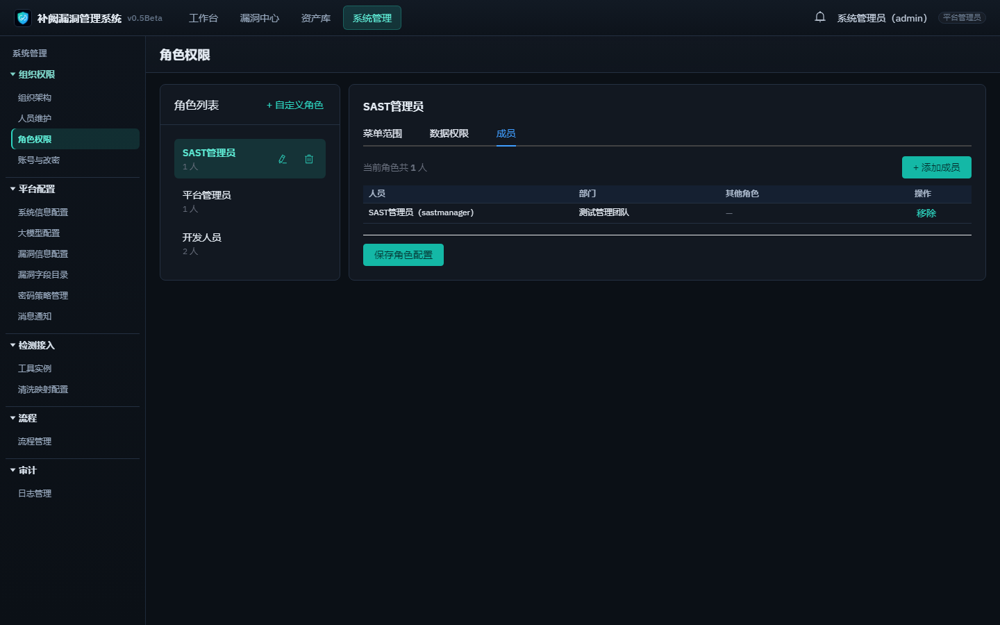

列出该角色人员，可 **添加成员** 或 **移除**。一人可兼多个角色。没有权限的顶栏模块和侧栏项不会出现。

### 8.4 账号与改密

路径：系统管理 → 组织权限 → **账号与改密**（也可从头像菜单进入）。页面标题为 **账号与密码**。

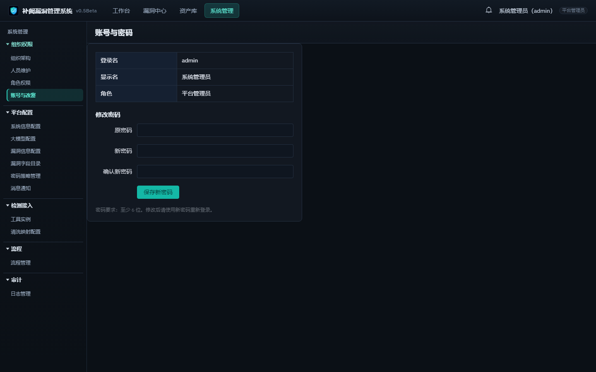

显示当前登录名、显示名、角色。修改自己的密码（原密码 / 新密码 / 确认）。须符合密码策略；保存后用新密码重新登录。强制改密时页顶有告警，改完前不能进其他页。

### 8.5 系统信息配置

路径：系统管理 → 平台配置 → **系统信息配置**


三块卡片：

| 块 | 内容 |
|----|------|
| 产品信息 | 产品名称、产品版本、产品简介（登录页副文案）；点本卡片 **保存** |
| 产品 Logo | 上传 / 更换 png、jpg、gif、webp、svg，不超过 2MB |
| 产品授权 | 授权码（掩码）、单位、到期日、最近更新；可 **导入授权文件**（`.lic` / `.txt`） |

默认品牌为 **补阙**。改名称/版本/Logo 后登录页和顶栏立即生效。**授权不再拦截登录**。

### 8.6 大模型配置

路径：系统管理 → 平台配置 → **大模型配置**


开启并接通后，漏洞详情才会出现「AI解读」，监管漏洞才会出现「通报提取」。未启用时这两处对使用者隐藏。模型输出只是草稿，写入漏洞字段或监管台账仍须人工确认。页面分两块：**接口与鉴权**、**提示词**。无修改权限的账号只能查看。

**接口与鉴权**

对接网上大模型或内部 API 网关（OpenAI Chat Completions 兼容）。填写接口地址、模型名、鉴权方式（Bearer Token 或 api-key 头）和 API Key，点 **测试连通** 后再 **保存**。接通后显示「已接通」。也可使用环境变量 `VULN_AI_BASE_URL` / `VULN_AI_API_KEY` / `VULN_AI_MODEL` / `VULN_AI_AUTH_TYPE`。网关需要时填写「额外请求头」JSON。

**提示词**

以列表维护条目。点行或 **修改** 打开对话框。

| 列 | 含义 |
|----|------|
| 名称 | 条目名称 |
| 用途 | 漏洞AI解读 / 监管通报提取 |
| 适用类型 | 预置为「通用默认」；类型专用条目显示对应平台漏洞类型 |
| 状态 | 预置 / 类型专用；改过的会标「已改」 |

预置两条用途：

- **漏洞AI解读**：漏洞详情页生成解读。未单独配置的漏洞类型都走这条通用默认。  
- **监管通报提取**：监管漏洞页从公文提取多条草稿。

需要按类型区分解读口径时，点 **新增条目**：选用途「漏洞AI解读」和某个已启用的平台漏洞类型，填写 **系统提示词** 和 **用户提示词**（可用占位符，点击插入）。该类型下已有条目则不能重复新增，改为直接修改。预置条目可 **恢复默认**；类型专用条目可 **删除**（删除后该类型重新沿用通用默认）。

解读结果固定为概述、业务影响、处理建议、误报核对、转交清单等字段，用于协助处置说明，不会改处置状态。

### 8.7 漏洞信息配置

路径：系统管理 → 平台配置 → **漏洞信息配置**。四个页签独立维护，右上角 **保存** 只提交当前页签。

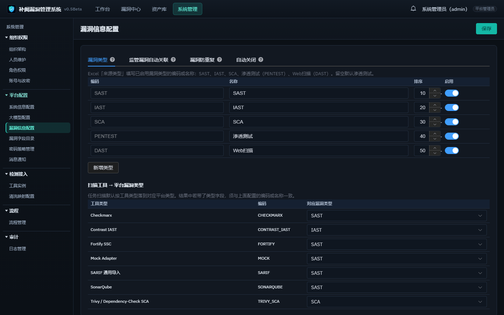

| 页签 | 作用 |
|------|------|
| 漏洞类型 | 维护平台类型（预置 SAST、SCA、渗透测试、Web扫描，可 **新增类型**、改名称、停用、删自定义）。Excel「来源类型」填编码或名称。下方「扫描工具 → 平台漏洞类型」决定任务扫描默认落到哪一类；结果若自带类型字段，须与此处编码或名称一致 |
| 监管漏洞自动关联 | 拖拽启用 CVE / 厂商编号 / CNVD / CNNVD / 组件 / 版本范围；保存后重匹配台账 |
| 漏洞防重复 | 启用开关；勾选匹配字段（同一工具实例、外部 ID、第三方漏洞编号、CVE、标题、指纹、代码分支等）。同一系统模块且字段都相同则视为同一条 |
| 自动关闭 | 本次扫描未再出现的历史漏洞可自动关闭 |

### 8.8 漏洞字段目录

路径：系统管理 → 平台配置 → **漏洞字段目录**

两个页签：

**扩展字段**


工具/手工录入落到详情「来源扩展字段」的字段。可 **新增字段**（标识、显示名、类型、适用来源、是否必填/列表/筛选）。预置字段只能编辑不能删；自定义字段可删。停用后详情不再展示。

**核心字段**

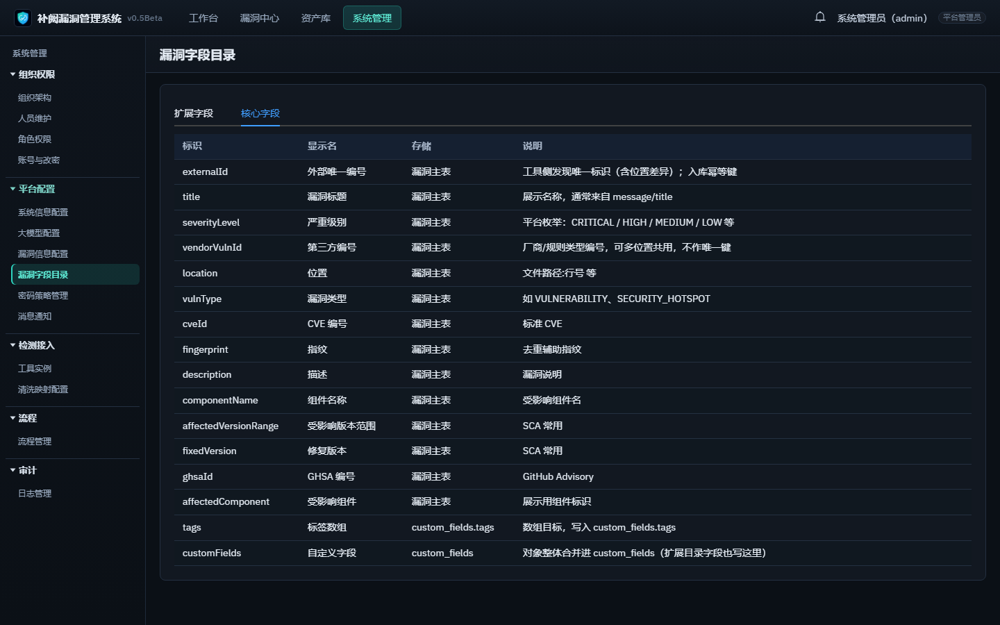

平台内置列（标题、级别、第三方编号、CVE 等）的只读说明：标识、存储位置、含义。不能在此增删，去重/匹配请到「漏洞信息配置」。

### 8.9 密码策略管理

路径：系统管理 → 平台配置 → **密码策略管理**

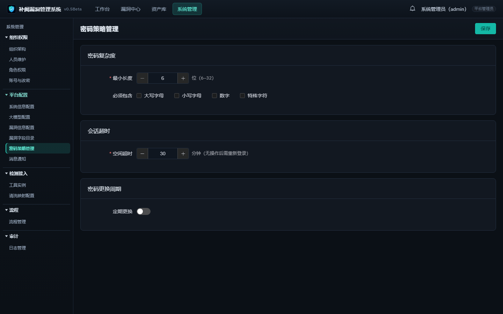

三块独立配置，右上角 **保存**：

| 块 | 项 |
|----|----|
| 密码复杂度 | 最小长度 6–32；必须包含：大写 / 小写 / 数字 / 特殊字符（可多选） |
| 会话超时 | 空闲超时（分钟，5–1440），无操作后需重新登录 |
| 密码更换周期 | 可关；开启后按天数到期，登录须先改密 |

保存后对新登录与改密生效。无修改权限的账号只能查看。

### 8.10 消息通知

路径：系统管理 → 平台配置 → **消息通知**

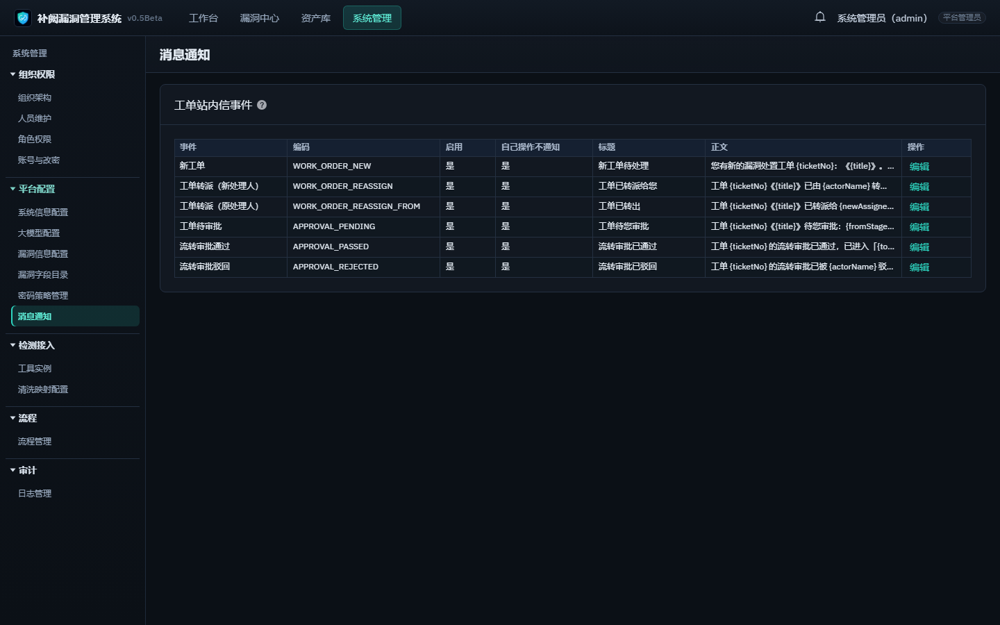

配置工单站内信事件是否启用、**自己操作不通知**，以及标题/正文里的占位符（如工单号、标题、处理人）。工作台「消息」按这里的模板投递。

### 8.11 工具实例

路径：系统管理 → 检测接入 → **工具实例**

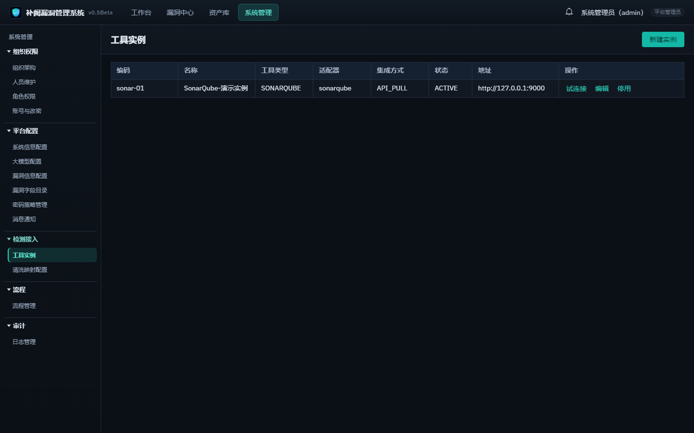

点 **新建实例**。列表行内：**试连接**、**编辑**、**停用**。SonarQube 实例在对话框里还有三个页签：

**集成配置**

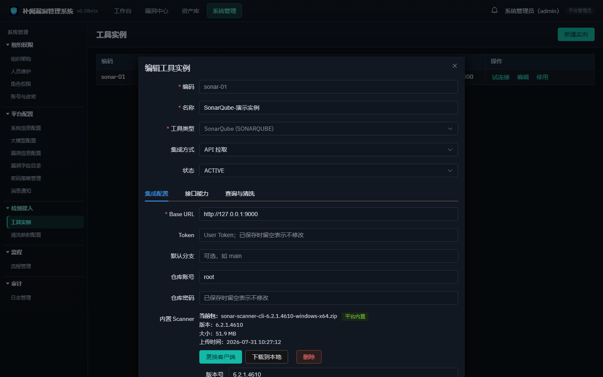

编码、名称、工具类型、集成方式（API 拉取 / 文件导入 / Webhook / CI/CD）、状态、Base URL、Token、默认分支、仓库账号密码，以及内置 Scanner 安装包的上传/下载/删除。

**接口能力**

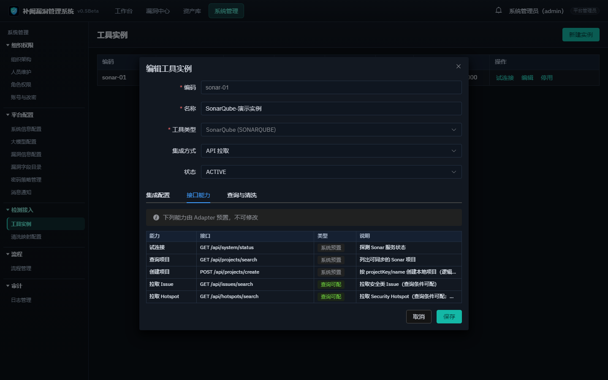

Adapter 预置能力（试连接、查项目、拉 Issue/Hotspot 等），不可改。标注「查询可配」的会受下一页签影响。

**查询与清洗**

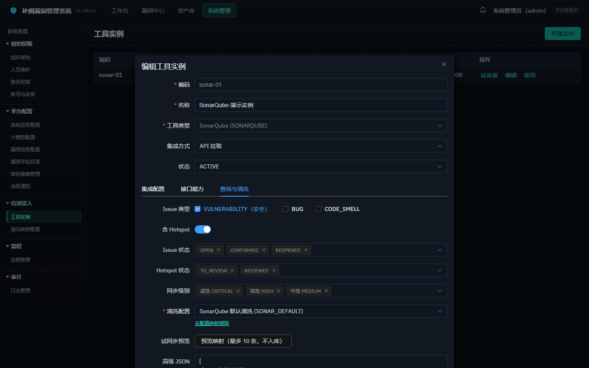

勾选要同步的 Issue 类型、是否含 Hotspot、Issue/Hotspot 状态、同步级别；必选一套清洗配置。已保存实例可 **预览映射**（最多 10 条，不入库）。高级用户可改 JSON。非 Sonar 类型一般没有这三页签，表单字段随工具类型变化。

### 8.12 清洗映射配置

路径：系统管理 → 检测接入 → **清洗映射配置**

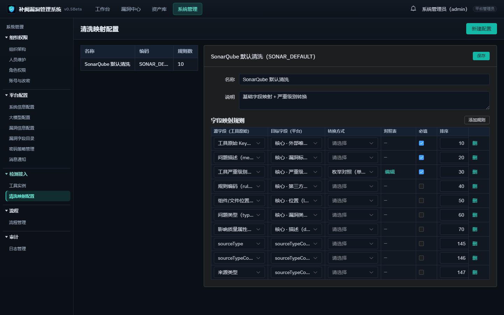

左侧配置列表，右侧编辑当前套。点 **新建配置**。把工具原始字段映射到平台字段（标题、第三方编号、级别等），保证入库后口径一致。预置配置不能删；自定义可删。支持枚举对照。

### 8.13 流程管理

路径：系统管理 → 流程 → **流程管理**

页面顶部四个页签。 **阶段与流转**、**版本** 必须先在「流程列表」点某条流程的 **查看** 或 **设计** 才会启用（未选中时为灰色）。当前流程名称、已发布版本、草稿版本显示在页签下方。

#### 流程列表

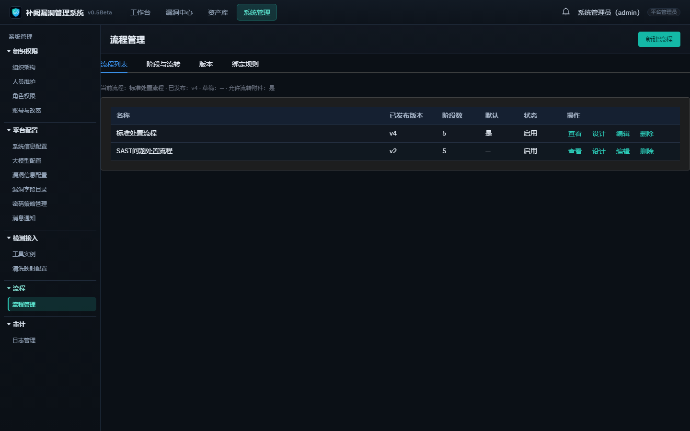

| 列 / 按钮 | 说明 |
|-----------|------|
| 新建流程 | 填编码、名称、描述；可设启用、默认流程、是否允许流转附件 |
| 已发布版本 | 工单实际走的版本；无则「—」 |
| 阶段数 | 当前已发布（或草稿）阶段个数 |
| 默认 | 未匹配到绑定规则时使用的流程 |
| 状态 | 启用 / 停用。停用后不再被新工单选中 |
| 查看 | 打开「阶段与流转」，**只读**看已发布版 |
| 设计 | 打开「阶段与流转」，优先编辑草稿 |
| 编辑 | 改名称、默认、附件开关，不改阶段图 |
| 删除 | 删除整条流程（有历史工单时需谨慎） |

漏洞「发起整改 / 批量发起处置」会按「绑定规则」选流程；都未命中则用默认流程。发起对话框会预览命中的流程、下一阶段处理人。

#### 阶段与流转

点 **设计** 或 **查看** 进入。已发布版本只读，改流程必须先有草稿。

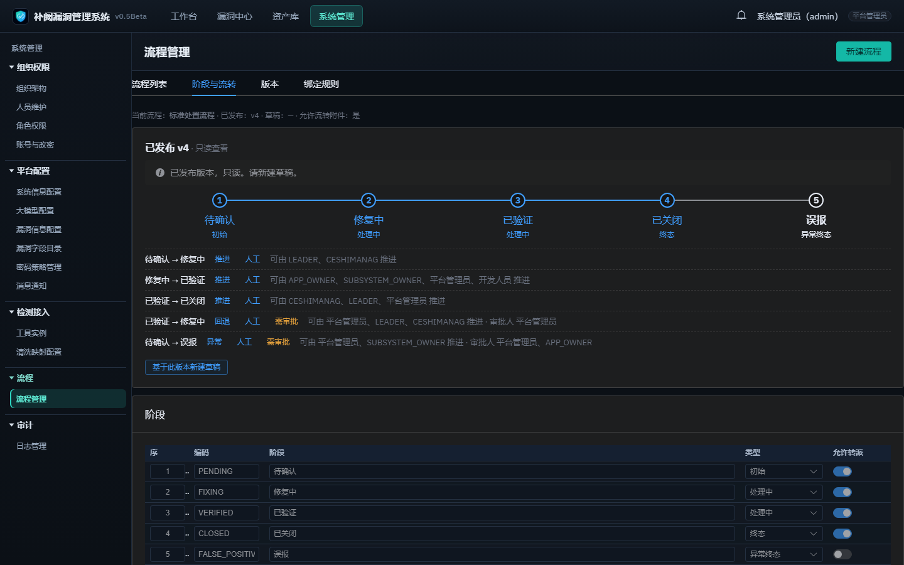

1. **预览条**：阶段按序排成步骤条（类型：初始 / 处理中 / 终态 / 异常终态）。下方列出每条流转边：源 → 目标、类型（推进 / 回退 / 异常）、触发（人工 / 复扫通过 / 复扫失败）、是否需审批、谁可点。  
2. 同时存在已发布和草稿时，右上可切换 **已发布 vN** / **草稿 vN**。只读时可 **基于此版本新建草稿**。  
3. **阶段表**：序号、编码、名称、类型、是否允许转派。可 **填入完整示例** 或 **新增阶段**。  
4. **流转边表**：源/目标阶段、类型、触发、允许角色（空=不限制）、是否审批、审批模式（或签 / 会签）、审批角色、审批用户、条件表达式、备注/附件是否必填。  
5. 改完点 **保存草稿**。提示：草稿不会立刻生效，必须到「版本」里 **发布**。

工单详情里的办理按钮、是否要附件/审批，都来自这里发布后的流转边。

#### 版本

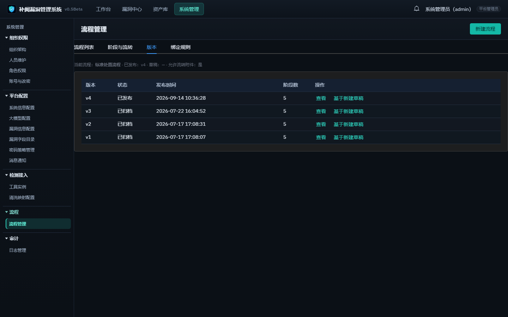

每个流程的历史版本列表。

| 状态 | 含义 | 可做的操作 |
|------|------|------------|
| 草稿 | 正在改、尚未生效 | **继续编辑** 回到阶段与流转；**发布** 后新工单走此版 |
| 已发布 | 当前生效版本 | **查看**；**基于新建草稿** 从该版复制一份再改 |
| 已归档 | 曾经发布、被新版本替代 | **查看**；也可基于它新建草稿 |

已在途工单继续走创建时的版本号，不会被新发布冲掉。改阶段后务必：保存草稿 → 本页发布。

#### 绑定规则

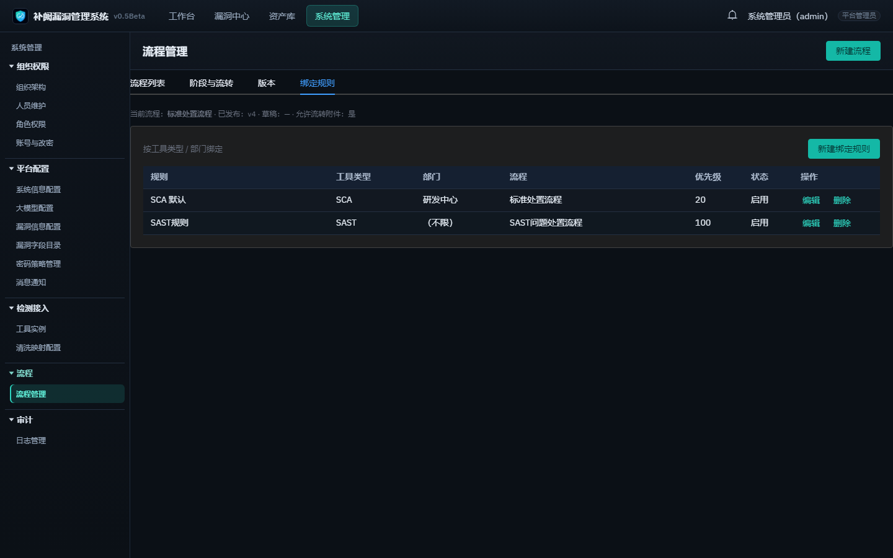

按 **工具类型** 和/或 **部门** 决定发起处置时用哪条流程。不依赖「当前选中的流程」，此页签始终可进。

点 **新建绑定规则**：规则名称、工具类型（可空=不限）、部门（可空=不限）、流程（必选）、优先级（**数字越小越优先**）、启用。

匹配顺序：启用规则按优先级排序，第一条工具类型与部门都匹配的胜出；都未命中则用流程列表里的默认流程。例如「SCA 默认」绑研发中心 + 标准处置流程，「SAST 规则」不限部门绑 SAST 问题处置流程。

### 8.14 日志管理

路径：系统管理 → 审计 → **日志管理**

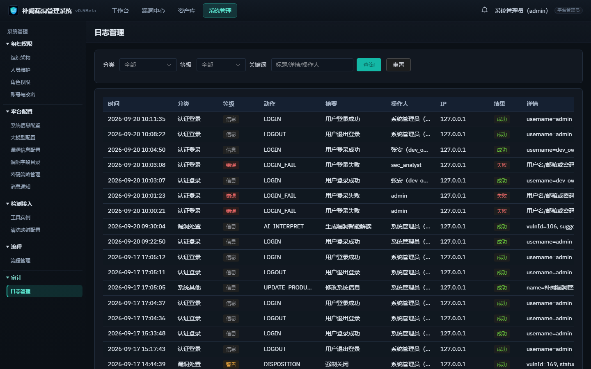

查询操作审计：登录成功/失败、配置变更（去重规则、监管匹配、自动关闭等）。可按分类、等级、关键词（标题/详情/操作人）筛选。列表含时间、分类、等级、动作、摘要、操作人、IP、结果、详情。

---

## 9. 推荐使用顺序

全新安装时组织、资产、漏洞均为空，请按这次序补齐：

1. 系统管理：组织架构 → 人员（可挂到部门）→ 角色权限。  
2. 资产库：项目 → 应用系统 → 系统模块（扫描和漏洞通常挂到模块）。  
3. 工具实例 + 清洗映射。  
4. 漏洞信息配置：先维护 **漏洞类型**（及扫描工具映射），再配置去重、监管匹配、自动关闭；需要时配置任务门禁。  
5. 若要用 AI解读 / 通报提取：大模型配置接通接口，按需为各漏洞类型增加解读提示词。  
6. 任务列表发起扫描（Sonar 点执行；其他工具回列表点重新拉取），在详情核对入库、门禁、监管命中。  
7. 漏洞列表处置或批量发起工单（也可手工录入 / Excel 导入）。  
8. 工作台办理工单。  
9. 报告列表下载归档。

监管场景：先在监管漏洞建台账（手工、Excel 或通报提取；厂商编号与扫描第三方编号一致）→ 再跑扫描 → 任务详情看「监管命中」，漏洞列表会出现「监管」标签。

---

## 10. 常见问题

**为什么组织、项目、漏洞都是空的？**  
全新安装和 Docker 安装包不再灌演示业务数据。预置的只有账号、角色、菜单、默认流程和平台配置。请先建组织与资产，再录入或扫描。

**登录页没有「导入授权」？**  
已取消登录授权校验，直接账号密码即可。授权文件仍可在「系统信息配置」导入，不影响登录。

**Docker 的 8080 和本机 5173 有什么区别？**  
安装包把前端静态页和接口都放在 8080。本机开发时 Vite 在 5173，后端仍在 8080。不要同时占用同一个 8080。

**为什么看不到「平台更新」？**  
当前版本关闭了该入口，不是权限缺失。

**建了监管条目，任务详情监管命中仍为 0？**  
匹配的是扫描漏洞的**第三方编号**与台账的**厂商编号**（或监管编号），不是只写在标题里。打开任务详情看「监管命中」页签；并确认该任务的发现里确有对应编号。漏洞详情里「监管漏洞」字段也应能看到台账编号。

**为什么看不到某个菜单？**  
角色未勾选对应权限。用管理员在「角色权限」中授权。顶栏四个模块也按权限隐藏。

**Excel 导入失败？**  
使用页面提供的模板；必填列不能空；编号冲突会按去重规则拒绝或更新。资产漏洞模板中的「来源类型」须为已启用的平台漏洞类型编码或名称（在「漏洞信息配置」维护）。监管台账的「来源类型」仍是两高一弱/监管通报等，不要混用。

**会话突然回到登录页？**  
空闲超时由「密码策略管理」控制，无操作后需重新登录。

**流程管理里「阶段与流转」「版本」是灰的？**  
先在「流程列表」点某条流程的 **查看** 或 **设计**，选中当前流程后这两个页签才可用。「绑定规则」不需要先选流程。

**改了阶段，工单按钮没变？**  
只保存了草稿。到「版本」页签把草稿 **发布** 后，**新发起**的工单才走新图；已在途工单仍用创建时的版本。

**发起检测任务页没有「执行」？**  
「执行」只对 SonarQube 类工具出现。其他工具请 **暂存退出**，再到任务列表点 **重新拉取**。

**发起任务时怎么选门禁策略？**  
发起页不选手动策略。在「任务门禁」建好并启用后，任务结束会按范围自动判定。

**AI解读或通报提取入口不见了？**  
「大模型配置」未启用、未保存密钥，或连通失败。启用并接通后，漏洞详情才会出现「AI解读」，监管漏洞才会出现「通报提取」。

**解读生成了但不进漏洞正文？**  
必须在「AI解读」里勾选要写入的字段，再点 **采纳并写入**。生成本身不会改描述、影响或修复建议。

**通报提取只出了一条，文里明明有多条？**  
提取应对文中全部漏洞列出草稿。检查「监管通报提取」提示词是否被改成只取一条；超长公文可分段粘贴后再提取。入库前请核对编号、CVE、时限。

**某条漏洞的解读口径和别的类型不一样？**  
该类型若在「大模型配置」里有专用提示词条目，就用专用；没有则用「漏洞AI解读」通用默认。可在提示词列表里看「适用类型」列。

**删除漏洞后还能看到？**  
列表不再显示（逻辑删除）。若提示无法删除，先结束该漏洞上的活跃工单。
